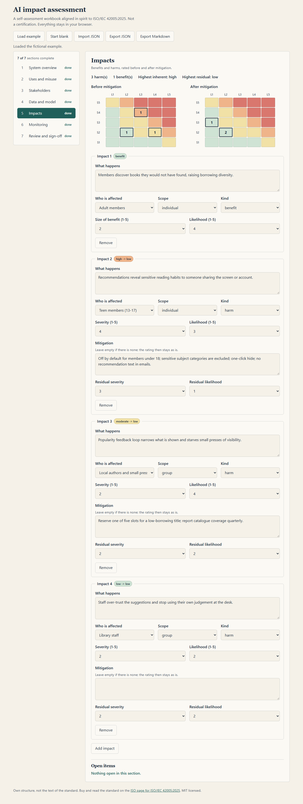
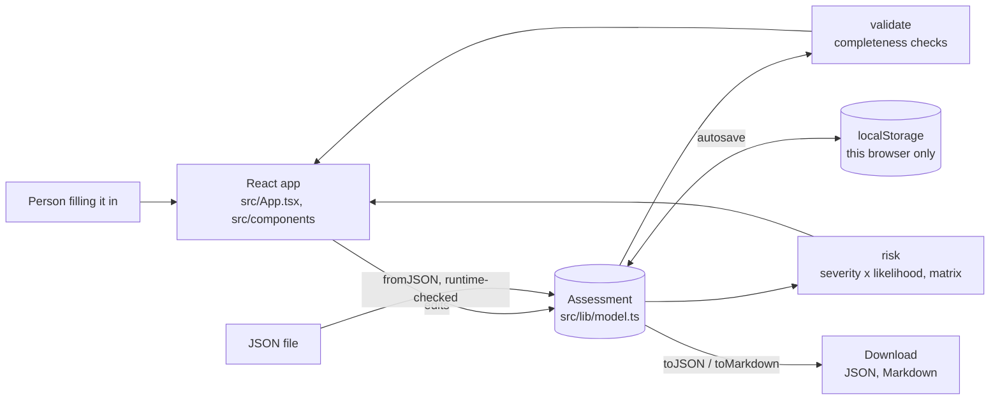
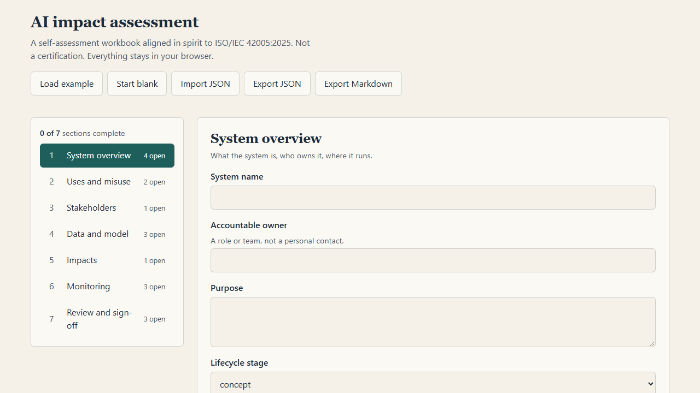
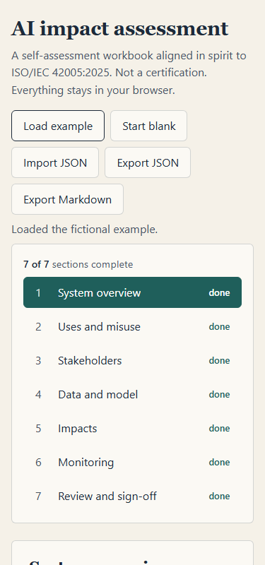
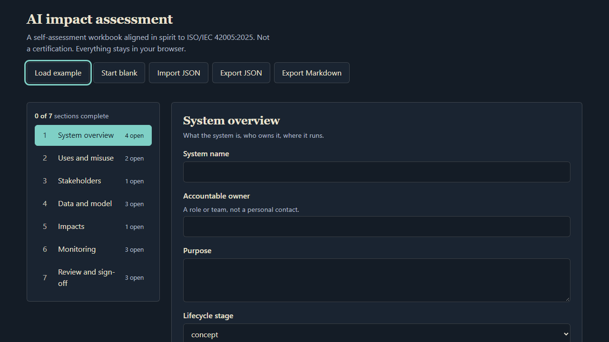

# ai-governance-toolkit

[](https://github.com/dc-tech-inc/ai-governance-toolkit/actions/workflows/ci.yml)
[](LICENSE)

Engineering reference by [DCtech.](https://dctech.live): a template and a small static web app for writing an **AI system impact assessment** that follows the shape of [ISO/IEC 42005:2025](https://www.iso.org/standard/42005.html), in strict TypeScript (React + Vite). You fill it in, it tells you what is still empty, rates harms before and after mitigation, and exports JSON or Markdown. It runs in the browser; nothing is uploaded.

> **Not an ISO document, not a certification, not a statement of conformity.** ISO/IEC 42005 is copyrighted. This repository contains **no text from the standard**: the section structure, wording, rating scale and checks are our own, and [`docs/alignment-map.md`](docs/alignment-map.md) says at topic level where they line up. To apply the standard properly, buy and read it on the [official ISO page](https://www.iso.org/standard/42005.html). Using this tool does not make anyone conformant to anything.



## The problem

An impact assessment is usually a blank document. People skip the awkward parts (who else is affected, what misuse is foreseeable, what happens after launch), and nothing tells them it is incomplete. This project turns the assessment into structured data, so completeness can be checked, harms can be rated before and after mitigation, and the result can be diffed, reviewed and exported like code.

## Architecture



The domain logic in `src/lib/` has no React in it; the UI is a thin form layer ([ADR 1](docs/adr/0001-plain-data-model-no-form-library.md)).

## What is inside

| Path | What it is |
|---|---|
| `src/lib/model.ts` | The assessment types (7 sections), `SECTIONS`, empty values |
| `src/lib/validate.ts` | Completeness checks. They say what is empty, not whether the content is good |
| `src/lib/risk.ts` | Severity x likelihood (1-25), four bands, residual score, 5x5 matrix counts ([ADR 3](docs/adr/0003-simple-risk-scoring.md)) |
| `src/lib/io.ts` | `toJSON`, runtime-validated `fromJSON` for untrusted files, `toMarkdown` ([ADR 2](docs/adr/0002-runtime-validation-of-imported-json.md)) |
| `src/lib/example.ts` | A **fictional** example: a library reading recommender |
| `src/lib/storage.ts` | Autosave that survives blocked or full browser storage |
| `docs/` | Alignment map, deploy notes, ADRs, screenshots produced by the e2e suite |

## Run it

Requirements: Node.js 24 and pnpm 11.

```bash
pnpm install
pnpm dev            # http://localhost:5173
```

```bash
pnpm lint && pnpm typecheck && pnpm test
pnpm coverage       # unit + component tests with thresholds
pnpm e2e            # builds, serves the build, drives headless Chromium (first run: pnpm exec playwright install chromium)
pnpm build          # static site in dist/
```

There is no server, no database and no environment variable, so there is no `.env.example` and no Docker image: `dist/` is plain static files ([ADR 4](docs/adr/0004-static-only.md)).

## How it works in practice

1. **Load example** (or start blank). The example is fictional and passes every check, so you can see what a finished one looks like.
2. Work through seven sections: system overview, uses and misuse, stakeholders, data and model, impacts, monitoring, review. The left ledger shows open items per section.
3. In **Impacts**, record benefits and harms. For each harm give severity and likelihood, then a mitigation and the residual rating. The two matrices show where harms sit before and after mitigation.
4. **Export JSON** to keep it under version control, **Export Markdown** to paste into a document or review. **Import JSON** loads it back; a malformed file is rejected with the field name and your draft is kept.

| Blank start | Phone width | Dark scheme |
|---|---|---|
|  |  |  |

## Tests

| Layer | What | Result |
|---|---|---|
| Unit and component (Vitest, jsdom, Testing Library) | scoring, validation, JSON round trip and rejection, Markdown escaping, storage failure, every form field writing through, download and import flows | 26 tests passing |
| Coverage (v8) | thresholds enforced in CI: lines 85, statements 85, functions 85, branches 75 | lines 98.0, statements 96.2, functions 95.0, branches 92.0 |
| End to end (Playwright, headless Chromium) | load example, export and re-import round trip, reload keeps the draft, bad file rejected, phone width without horizontal scroll, dark scheme and focus ring; the screenshots in this README come from it | 7 tests passing |

CI also runs ESLint, `tsc` in strict mode, a production build, secretlint on the working tree and gitleaks (release binary, checksum verified) on the full history. End-to-end runs on pull requests and manual dispatch only, to spare private-repository minutes.

## Limitations

- **A workbook, not an authority.** It does not tell you whether an AI system is acceptable, and the risk bands are a convention ([ADR 3](docs/adr/0003-simple-risk-scoring.md)), not a method taken from any standard.
- **Completeness is not quality.** A section with no open items can still be wrong or shallow.
- **Single user, single browser.** The draft lives in `localStorage` and in files you export. There is no sharing, accounts or history; use git for that.
- **Do not put real personal data in it.** Describe data, do not paste it.
- **The alignment is ours.** The map in `docs/alignment-map.md` was written from public descriptions of the standard, not from the licensed text, and its clause titles are deliberately not quoted. Check it against the standard before relying on it.
- Accessibility was designed in (labels, focus rings, 44 px targets, tables with captions, no colour-only signals) and checked by a few automated assertions, **not** by a screen-reader audit.

## Deploying the demo

A GitHub Pages workflow is included and **is inert while the repository is private**: Pages is not enabled and the job is skipped. See [`docs/deploy.md`](docs/deploy.md).

## Roadmap

Open issues track the next steps: a printable report view, multiple systems in one workspace, and a JSON Schema file for the export. Contributions: [CONTRIBUTING.md](CONTRIBUTING.md). Security: [SECURITY.md](SECURITY.md).

## Resumo em português

Modelo e app estático (React + TypeScript estrito) para preencher uma avaliação de impacto de sistema de IA, com estrutura própria alinhada de forma geral à ISO/IEC 42005:2025. Verifica o que falta, classifica danos antes e depois da mitigação e exporta JSON e Markdown. Roda inteiramente no navegador. **Não reproduz o texto da norma** (protegido por direitos autorais da ISO) e **não é certificação nem declaração de conformidade**.

## License

MIT, Copyright (c) 2026 DC TECH INC. The standard itself is not part of this repository and is not covered by this license.
